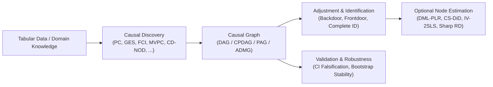

# causal.js

[](https://www.npmjs.com/package/@kanaries/causal)
[](https://www.npmjs.com/package/@kanaries/causal)
[](https://github.com/Kanaries/causal-js/actions/workflows/ci.yml)
[](LICENSE)
[](package.json)

**Causal discovery and causal inference for JavaScript and TypeScript — running natively in Node.js and the browser.**

`@kanaries/causal` brings constraint-based, score-based, permutation, functional, and latent-confounder causal discovery algorithms together with DAG/ADMG causal graph modeling, symbolic causal effect identification (backdoor, frontdoor, and complete ID), graph falsification, bootstrap stability analysis, and structured AI-agent diagnostics — with **zero Python required** for the portable core.

[Why causal.js](#why-causaljs) · [Quick Start](#quick-start) · [Algorithms](#supported-algorithms) · [Causal Workflow](#causal-inference-workflow) · [AI Agents](#built-for-ai-agents) · [Scope & Boundaries](#scope--boundaries) · [FAQ](#frequently-asked-questions) · [Docs](#documentation--examples)

---

## Why causal.js?

Most causal discovery and causal inference libraries (`causal-learn`, `DoWhy`, `EconML`, `dagitty`) live exclusively in Python or R. **causal.js (`@kanaries/causal`)** brings principled causal analysis directly to the JavaScript and TypeScript ecosystem:

- **Browser & Node.js Native (Zero-Python Core)**: Run causal discovery, conditional independence tests, score functions, causal graph operations, and symbolic effect identification directly in browsers, Web Workers, or Node.js — no Python runtime or backend server needed.
- **11 Causal Discovery Algorithms**: Includes `PC`, `MVPC` (missing values), `FCI`, `CD-NOD`, `GES`, `ExactSearch` (DP & A*), `GRaSP`, `GIN`, `CAM-UV`, `RCD`, and pairwise `ANM`, paired with `Fisher-Z`, `Chi-square`, `G-square`, `KCI`, `Gaussian BIC`, and `BDeu`.
- **DAG & ADMG Identification**: Supports backdoor adjustment sets, frontdoor witnesses, and an experimental **complete ID algorithm** (`identifyById` / `backend: "id"`) for observed DAGs and Acyclic Directed Mixed Graphs (ADMGs) with bidirected edges and bows.
- **End-to-End Structural Workflow**: A **production-scope**, **DAG-first** task layer (`discoverGraph` → `findAdjustmentSets` → `identifyEffect` → `falsifyGraph` → `stabilityAnalysis`) with explicit contracts and no silent fallbacks.
- **Built for AI Agents**: Every algorithm and task exposes machine-readable metadata (`describeAlgorithm()`, `describeTask()`) and returns a structured `result.agent` envelope containing diagnostics, degradations, provenance, next actions, and scoped validation evidence.
- **Optional Curated Estimation (Node.js)**: Need numerical treatment-effect estimation? `@kanaries/causal/node` includes an optional Python adapter (StatsPAI `1.39.5`) for `DML-PLR`, `CS-DiD`, `IV-2SLS`, and `Sharp RD`.
- **Parity-Tested Against `causal-learn`**: Core discovery algorithms are regression-tested against Python `causal-learn` baselines through the external [`Kanaries/causal-parity`](docs/testing/external-regression.md) suite.



---

## Installation

Requires **Node.js 20+** (or any modern browser / ESM bundler).

```bash
npm install @kanaries/causal
# or: pnpm add @kanaries/causal | yarn add @kanaries/causal | bun add @kanaries/causal
```

Upgrading from `0.2.x`? See the [0.3.0 migration notes](CHANGELOG.md#upgrading-from-021).

---

## Quick Start

### 1. Causal Discovery from Tabular Data (`PC`)

Discover causal structure directly from numeric data in Node.js or the browser:

```ts
import { DenseMatrix, FisherZTest, pc } from "@kanaries/causal";

const data = new DenseMatrix(rows); // rows: number[][]
const result = pc({
  data,
  ciTest: new FisherZTest(data),
  alpha: 0.05,
  stable: true,
  ucRule: 0,
  ucPriority: 2
});

console.log(result.graph);
```

### 2. Causal Effect Identification & Validation (DAG-First Workflow)

Model a causal graph, compute valid backdoor adjustment sets, derive symbolic estimands, test implied conditional independences against data, and evaluate bootstrap stability:

```ts
import {
  CausalGraph,
  DenseMatrix,
  FisherZTest,
  GRAPH_KIND,
  discoverGraph,
  findAdjustmentSets,
  identifyEffect,
  falsifyGraph,
  stabilityAnalysis
} from "@kanaries/causal";

// 1. Define a causal DAG: Z -> X -> Y and Z -> Y
const graph = CausalGraph.fromNodeIds(["X", "Y", "Z"], { kind: GRAPH_KIND.dag });
graph.addDirectedEdge("Z", "X");
graph.addDirectedEdge("Z", "Y");
graph.addDirectedEdge("X", "Y");

// 2. Find valid backdoor adjustment sets and identify the causal effect P(Y | do(X))
const adjustment = findAdjustmentSets({
  graph: graph.toShape(),
  treatment: "X",
  outcome: "Y"
});

const identified = identifyEffect({
  graph: graph.toShape(),
  treatment: "X",
  outcome: "Y"
});

console.log(adjustment.candidateSets);       // [["Z"]]
console.log(identified.method);              // "backdoor"
console.log(identified.estimandSpec?.expression);
```

For a complete runnable discovery-to-validation script (including `discoverGraph`, `falsifyGraph`, and `stabilityAnalysis`), see [`examples/step3-task-workflow.ts`](examples/step3-task-workflow.ts) and [End-to-End Workflow](docs/tasks/end-to-end-workflow.md).

<details>
<summary><strong>More Examples: GES, CD-NOD, ExactSearch, GIN, Pairwise ANM, Complete ID (ADMG), Node/Web Facades</strong></summary>

#### Score-Based Discovery (`GES`)

```ts
import { DenseMatrix, GaussianBicScore, ges } from "@kanaries/causal";

const data = new DenseMatrix(rows);
const result = ges({
  data,
  score: new GaussianBicScore(data)
});

console.log(result.cpdag);
```

#### Exact DAG Search (`ExactSearch`)

```ts
import { DenseMatrix, GaussianBicScore, exactSearch } from "@kanaries/causal";

const data = new DenseMatrix(rows);
const result = exactSearch({
  data,
  score: new GaussianBicScore(data),
  searchMethod: "astar" // or "dp"
});

console.log(result.dag);
```

#### Nonstationary / Multi-Domain Discovery (`CD-NOD`)

```ts
import { DenseMatrix, FisherZTest, cdnod } from "@kanaries/causal";

const data = new DenseMatrix(rows);
const context = [1, 1, 1, 2, 2, 2];
const result = cdnod({
  data,
  context,
  alpha: 0.05,
  createCiTest: (augmentedData) => new FisherZTest(augmentedData),
  ucRule: 0,
  ucPriority: 2
});

console.log(result.contextNodeIndex);
```

#### Latent-Variable Discovery (`GIN`)

```ts
import { DenseMatrix, gin } from "@kanaries/causal";

const data = new DenseMatrix(rows);
const result = gin({
  data,
  indepTestMethod: "kci",
  alpha: 0.05
});

console.log(result.causalOrder);
```

#### Pairwise Additive Noise Model (`ANM`)

```ts
import { anm } from "@kanaries/causal";

const score = anm(x, y);
console.log(score.forwardPValue);  // x -> y: independence of x and fitted y residual
console.log(score.backwardPValue); // y -> x: independence of y and fitted x residual
```

> `anm` is deterministic and browser-safe. Its default regression is a standardized RBF kernel posterior mean (an intentional portable approximation rather than sklearn's continuously optimized Gaussian process). Supply a custom `AnmRegressor` via `options.regressor` when needed.

#### Complete ID on ADMGs with Unobserved Confounders (`identifyEffect` / `identifyById`)

```ts
import { CausalGraph, GRAPH_KIND, identifyEffect, identifyById } from "@kanaries/causal";

// Frontdoor ADMG: X -> M -> Y with latent confounding X <-> Y
const graph = CausalGraph.fromNodeIds(["X", "M", "Y"], { kind: GRAPH_KIND.admg });
graph.addDirectedEdge("X", "M");
graph.addDirectedEdge("M", "Y");
graph.addBidirectedEdge("X", "Y");

const result = identifyEffect({
  graph: graph.toShape(),
  treatment: "X",
  outcome: "Y",
  backend: "id" // "auto" also selects "id" for ADMGs
});

console.log(result.identifiable);                 // true
console.log(result.estimandSpec?.expressionTree); // symbolic AST with sums, products, quotients

// Joint treatment / outcome queries
const joint = identifyById({
  graph: graph.toShape(),
  treatment: ["X"],
  outcome: ["M", "Y"]
});
```

#### Runtime Facades & Capability Detection (`Node` / `Web`)

```ts
import {
  detectNodeRuntimeCapabilities,
  nodeAlgorithmCatalog,
  isNodeAlgorithmSupported
} from "@kanaries/causal/node";

console.log(detectNodeRuntimeCapabilities());
console.log(nodeAlgorithmCatalog.map((entry) => entry.id));
console.log(isNodeAlgorithmSupported("pc"));
```

```ts
import {
  detectWebRuntimeCapabilities,
  webAlgorithmCatalog,
  isWebAlgorithmSupported
} from "@kanaries/causal/web";

console.log(detectWebRuntimeCapabilities());
console.log(webAlgorithmCatalog.map((entry) => entry.id));
console.log(isWebAlgorithmSupported("pc"));
```

</details>

---

## Supported Algorithms

All 11 discovery algorithms run portably in **Node.js and browsers** with zero Python dependencies.

| Algorithm | Function | Family | Best For / Assumptions | Worker Support |
| --- | --- | --- | --- | --- |
| **PC** | `pc()` | Constraint-based | General CPDAG discovery (no latent confounders) | Node & Web |
| **MVPC** | `mvpc()` | Constraint-based | Discovery under missing data (`MvFisherZTest`) | CPU |
| **FCI** | `fci()` | Constraint-based | PAG discovery allowing latent confounders & selection bias | Node & Web |
| **CD-NOD** | `cdnod()` | Constraint-based | Nonstationary or multi-domain / heterogeneous data | Node & Web |
| **GES** | `ges()` | Score-based | Greedy Equivalence Search (`GaussianBicScore`, `BDeuScore`) | Node & Web |
| **ExactSearch** | `exactSearch()` | Score-based | Globally optimal DAG search via DP or A* (small/medium graphs) | CPU |
| **GRaSP** | `grasp()` | Permutation-based | Relaxed faithfulness causal order / CPDAG search | CPU |
| **GIN** | `gin()` | Latent-variable | Linear non-Gaussian latent cluster discovery (`hsic` / `kci`) | CPU |
| **CAM-UV** | `camuv()` | Functional (nonlinear) | Nonlinear additive causal discovery with unobserved variables | CPU |
| **RCD** | `rcd()` | Functional (LiNGAM) | Linear non-Gaussian discovery with latent confounders | CPU |
| **ANM** | `anm()` | Pairwise functional | Pairwise causal direction evidence (`x -> y` vs `y -> x`) | CPU |

**Included Statistical Primitives**:
- **Conditional Independence (CI) Tests**: `FisherZTest`, `ChiSquareTest`, `GSquareTest`, `KciTest` (unconditional & conditional kernel independence), `MvFisherZTest`, `DSeparationTest`.
- **Local Score Functions**: `GaussianBicScore`, `BDeuScore`.

---

## Causal Inference Workflow

Beyond raw discovery algorithms, `@kanaries/causal` provides a task-oriented workflow with stable, typed result contracts:

| Step | API | What It Does | Status |
| --- | --- | --- | --- |
| **1. Discover** | `discoverGraph()` | Wraps discovery algorithms behind a unified task result | Production-scope |
| **2. Bridge** | `resolveDagForTasks()` | Explicitly bridges CPDAG outputs to a DAG with caveats | Production-scope |
| **3. Adjust** | `findAdjustmentSets()` / `isAdjustmentSet()` | Computes and validates constructive backdoor adjustment sets | Production-scope (DAG-first) |
| **4. Identify** | `identifyEffect()` / `identifyById()` | Derives symbolic `P(Y \| do(X))` estimands via backdoor, frontdoor, zero-effect, or complete ID on DAGs & ADMGs | DAG witness: Production-scope<br/>Complete `id`: Experimental |
| **5. Falsify** | `falsifyGraph()` | Runs DAG sanity checks + implied CI tests (with optional Benjamini-Hochberg correction) | Production-scope (DAG-first) |
| **6. Stabilize** | `stabilityAnalysis()` | Bootstraps discovery runs to measure edge frequency & robustness | Production-scope |
| **7. Estimate** | `createStatsPaiAdapter().estimateEffect()` | Curated numerical estimation (`dml-plr`, `cs-did`, `iv-2sls`, `rd-sharp`) via optional Node-only Python StatsPAI `1.39.5` | Experimental (Node-only) |

### Optional Numerical Estimation (`@kanaries/causal/node`)

When you need numerical treatment-effect estimation in Node.js, `@kanaries/causal/node` provides an explicit, opt-in Python adapter backed by **StatsPAI `1.39.5`**:

- `dml-plr`: Double Machine Learning — Partially Linear Regression (`theta`)
- `cs-did`: Callaway–Sant'Anna Difference-in-Differences (`att`)
- `iv-2sls`: Two-Stage Least Squares Instrumental Variables (`iv-coefficient`)
- `rd-sharp`: Sharp Regression Discontinuity (`rd-local-effect`)

Importing `@kanaries/causal/node` never spawns Python; subprocesses start only when `probe()` or `estimateEffect()` is invoked. Selecting an estimator and its causal design is always explicit — graph identification does not automatically construct an estimator. See [Optional Python Estimation](docs/tasks/python-estimation.md) and [`examples/python-estimation.ts`](examples/python-estimation.ts).

---

## Built for AI Agents

Modern LLM agents and automated data-science pipelines need more than raw adjacency matrices — they need to know **when a method applies**, **what checks actually ran**, and **what to do next**.

```ts
import { describeAlgorithm, describeTask, identifyEffect } from "@kanaries/causal";

// Inspect assumptions, preconditions, input schemas, and cost before running
const pcMeta = describeAlgorithm("pc");
const idMeta = describeTask("identifyEffect");

// Every task returns a JSON-compatible `result.agent` envelope
const result = identifyEffect({ graph: graph.toShape(), treatment: "X", outcome: "Y" });
console.log(result.agent.diagnostics);   // passed / failed / inconclusive / not_run
console.log(result.agent.degradations);  // truncations or caveats
console.log(result.agent.nextActions);   // prioritized follow-up recommendations
console.log(result.agent.provenance);    // effective config, backend, seed
console.log(result.agent.validation);    // output-scoped test coverage evidence
```

See the [Agent Contract](docs/tasks/agent-contract.md) and [`examples/agent-metadata.ts`](examples/agent-metadata.ts).

---

## Package Entry Points

All capabilities are published under a single npm package (`@kanaries/causal`) with three explicit entry points:

| Entry Point | Target Runtime | Included Surface |
| --- | --- | --- |
| `@kanaries/causal` | Node.js & Browser | Portable graph IR (DAG/CPDAG/PAG/ADMG), matrices, CI tests, scores, all 11 discovery algorithms, task workflow, complete ID, agent metadata |
| `@kanaries/causal/node` | Node.js 20+ | Portable surface + Node runtime capability detection, worker helpers, and optional StatsPAI Python estimation adapter |
| `@kanaries/causal/web` | Modern Browsers | Portable surface + Browser/WebWorker/WebGPU capability detection and browser worker helpers |

---

## Scope & Boundaries

`causal.js` prioritizes explicit scientific contracts over silent heuristics:

- **Production-scope vs. Experimental**: The task workflow is **production-scope** within its explicitly bounded **DAG-first** contract (adjustment sets, DAG witness identification, implied-CI falsification, and bootstrap stability). The complete `id` backend (DAGs & ADMGs with bows) and the Node-only StatsPAI estimation adapter are explicitly marked **experimental**.
- **Not yet in scope**: PAG/MAG identification, conditional-effect `IDC`, counterfactuals, permutation-based falsification, and automatic estimator construction from symbolic formulas.
- **What results do not prove**:
  - Surviving `falsifyGraph()` (`not falsified`) is **not** proof of causal truth.
  - A high bootstrap edge frequency from `stabilityAnalysis()` is a **robustness signal**, not a correctness proof.
  - Agent `validation` evidence reflects configuration-scoped test artifacts — it does not validate a new dataset or verify causal assumptions.
- **Discovery parity boundaries**: `PC`, `GES`, `CD-NOD`, `ExactSearch`, `GIN`, `GRaSP`, and `RCD` are covered on selected deterministic paths in `causal-parity`. `CAM-UV` uses a portable additive spline smoother (`pspline` / backfitting) instead of `pygam.LinearGAM`, and `RCD` uses a portable numeric optimizer instead of SciPy `fmin_l_bfgs_b`.

For full details, see [Release Status & Parity Boundaries](docs/v1-status.md), [Backend Selection Guide](docs/tasks/backend-selection.md), and [Operational Readiness](docs/tasks/operational-readiness.md).

---

## Frequently Asked Questions

### Can I run causal discovery in the browser without Python?
Yes. The root `@kanaries/causal` and browser `@kanaries/causal/web` entry points are 100% JavaScript/TypeScript with zero Python or native binary dependencies. All 11 discovery algorithms, conditional independence tests, graph primitives, and symbolic identification (including complete ID) run directly in the browser or Web Workers.

### How does `causal.js` compare to Python's `causal-learn` and `DoWhy`?
`causal.js` implements many of the core discovery algorithms popularized by `causal-learn` (`PC`, `MVPC`, `FCI`, `CD-NOD`, `GES`, `ExactSearch`, `GRaSP`, `GIN`, `CAM-UV`, `RCD`, `ANM`) and a `DoWhy`-style structural workflow (discovery → adjustment/identification → falsification → stability) natively in TypeScript, plus Shpitser–Pearl complete ID for ADMGs and structured AI-agent contracts. Unlike `DoWhy`, `causal.js` keeps its core pure JavaScript/TypeScript and scopes numerical estimation to an explicit, opt-in Node.js StatsPAI adapter.

### Does `causal.js` support unobserved (latent) confounders?
Yes, in both discovery and identification:
- **Discovery**: `FCI`, `GIN`, `CAM-UV`, and `RCD` handle latent confounders.
- **Identification**: `CausalGraph` supports ADMGs (`GRAPH_KIND.admg`) with bidirected edges (`X <-> Y`) and bows (`X -> Y` and `X <-> Y` simultaneously), and `identifyEffect(..., { backend: "id" })` / `identifyById()` implements complete unconditional ID with explicit non-identifiability failure witnesses.

### When do I need Python with `@kanaries/causal`?
Only if you explicitly call `createStatsPaiAdapter().estimateEffect()` from `@kanaries/causal/node` to run `dml-plr`, `cs-did`, `iv-2sls`, or `rd-sharp`. Every other feature in `@kanaries/causal` works without Python installed.

### Is `causal.js` suitable for AI agents and LLM tool-calling?
Yes. You can inspect method assumptions, preconditions, and schemas via `describeAlgorithm()` / `describeTask()`, and consume structured diagnostics, degradations, provenance, and follow-up actions from `result.agent` on every task call.

---

## Documentation & Examples

| Guide | Description |
| --- | --- |
| [Task Workflow Index](docs/tasks/index.md) | Overview of the DAG-first workflow and result boundaries |
| [End-to-End Workflow](docs/tasks/end-to-end-workflow.md) | Runnable discovery-to-estimation walkthrough |
| [Complete ID & ADMG Bows](docs/tasks/id-identification.md) | Symbolic identification on DAGs & ADMGs and expression AST contract |
| [Backend Selection](docs/tasks/backend-selection.md) | Choosing between `auto`, `dag-first-mvp`, `dag-backdoor-only`, and `id` |
| [Agent Contract](docs/tasks/agent-contract.md) | Method introspection, `result.agent` envelope, and diagnostic statuses |
| [Optional Python Estimation](docs/tasks/python-estimation.md) | Provisioning StatsPAI `1.39.5` and configuring `dml-plr`, `cs-did`, `iv-2sls`, `rd-sharp` |
| [Result Contract](docs/tasks/result-contract.md) | Stable field-level contract for task outputs |
| [Release Status & V1 Boundaries](docs/v1-status.md) | Algorithm parity matrix and accepted boundaries |
| [Operational Readiness](docs/tasks/operational-readiness.md) | Release verification commands and evidence boundaries |
| [Architecture](docs/architecture.md) & [Roadmap](docs/roadmap.md) | Workspace design and future direction |

**Runnable TypeScript Examples**: [`step3-task-workflow.ts`](examples/step3-task-workflow.ts) · [`id-identification.ts`](examples/id-identification.ts) · [`agent-metadata.ts`](examples/agent-metadata.ts) · [`python-estimation.ts`](examples/python-estimation.ts) · [`known-effect.mjs`](packages/causal/examples/known-effect.mjs)

---

## Architecture & Local Development

This repository is a `pnpm` monorepo whose internal packages (`@causal-js/core`, `@causal-js/discovery`, `@causal-js/tasks`, `@causal-js/node`, `@causal-js/web`) are bundled at build time into the single public npm package `@kanaries/causal`.

```bash
pnpm install
pnpm typecheck
pnpm build
pnpm test
pnpm test:integration
pnpm typecheck:examples
```

To inspect the publishable package tarball locally:

```bash
pnpm pack:causal
```

When modifying graph semantics, CI tests, scores, or discovery behavior, also run the external Python parity suite ([details](docs/testing/external-regression.md)):

```bash
cd ../causal-parity
CAUSAL_JS_SOURCE_ROOT=../causal-js pnpm test
```

---

## License

[Apache-2.0](LICENSE)
